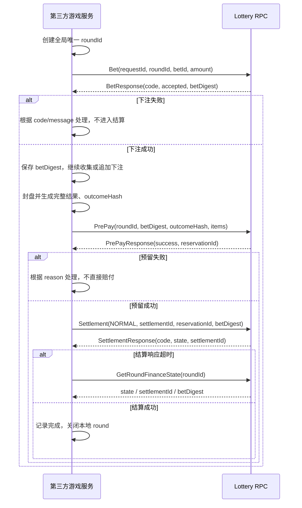
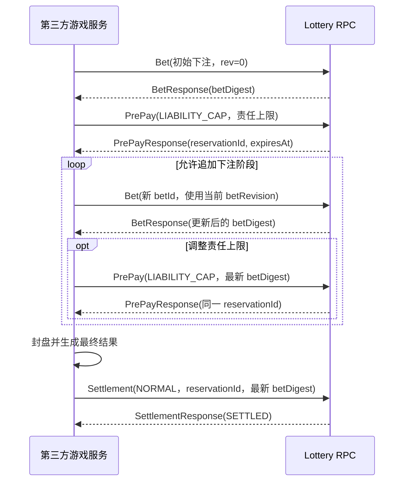
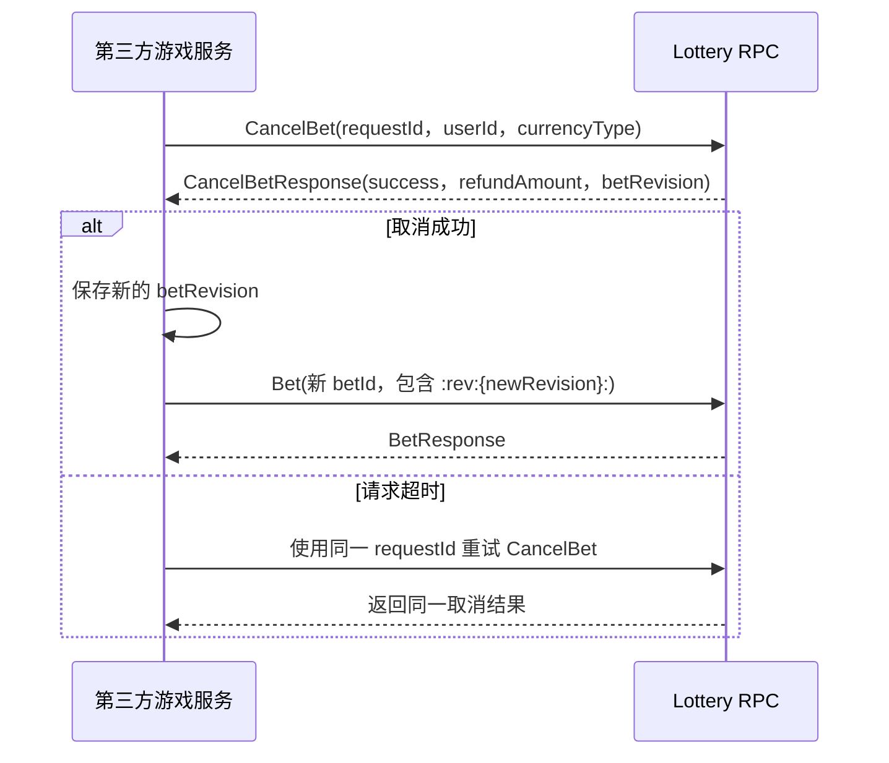
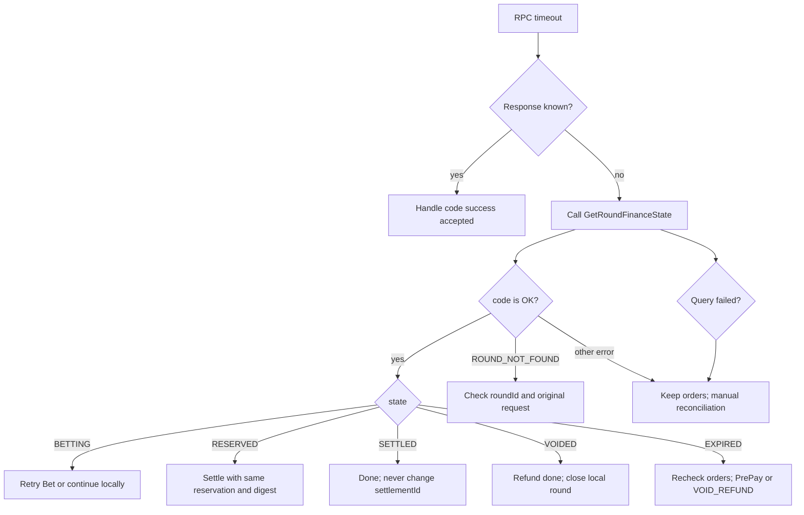
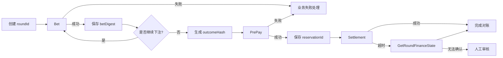
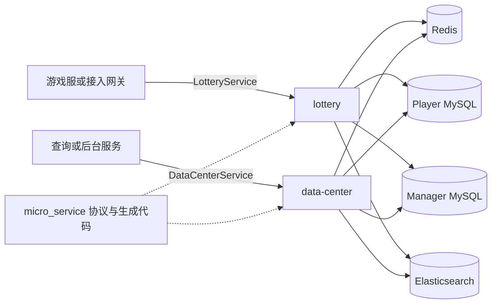

# 统一资金 RPC 协议草案与完整开发文档

> 更新日期：2026-11-05。本文统一合并原 Lottery 对接文档、当前功能与流程、统一资金协议草案、资金安全保证及项目架构详细报告，作为唯一开发文档。覆盖 `micro_service/proto` 全部 19 个 RPC：玩家与数据中心 12 个、统一资金与控制 7 个；包括请求、响应、公共结构、调用示例、内部流程与安全边界。

获取玩家信息直接阅读 [GetPlayer 请求、响应和调用示例](#rpc-getplayer)，玩家完整字段见 [HumanPlayer 字段说明](#human-player-fields)。`datacenter.proto` 的 12 个接口均有独立说明，不能只阅读 Lottery 资金接口章节。

| 阅读目标 | 文内入口 |
| --- | --- |
| 全部 RPC 清单 | [19 个接口及所属服务](#rpc-index) |
| 玩家信息、缓存、游戏列表、历史注单、session 和玩家锁 | [DataCenterService 完整对接](#datacenter-apis) |
| 下注、预留、结算、退款和取消下注 | [Bet 起的资金接口章节](#rpc-bet) |
| 预留续期与水池控制决策 | [RenewReservation](#rpc-renewreservation)、[GetPoolControlDecision](#rpc-getpoolcontroldecision) |
| 奖池会计、幂等、回收和故障边界 | [资金安全保证](#finance-safety) |
| 四份完整 proto 与字段号 | [完整协议定义](#proto-definitions) |
| 服务架构、启动、存储、配置和后台任务 | [项目架构与实现流程](#project-architecture) |
| 草案设计约定与历史描述修正 | [协议方案与开发约束](#protocol-design) |
| 已知问题、部署和联调验证 | [运维与开发验证](#operations) |

接口字段和字段号以第 26 节 proto 原文为准，当前行为以本文章节和对应实现为准。原文重复内容已合并；过时的无续期、无 ledger、无钱包幂等和无归档等表述已按当前实现修正，不再作为开发要求。

---

> 资金安全说明源于原 2026-03 文档，合并时按当前实现核对，含 reservation ledger、Settlement 钱包幂等和终态冷归档。
> 本文区分「正常路径会计正确」与「崩溃/重试下的严格保证」，避免把前者误当成后者。

---

<a id="finance-safety"></a>

## 1. 一句话结论

| 说法 | 是否成立 |
| --- | --- |
| 正常路径：结算后「实付进 P + 整笔释放 Q」，剩余预扣回到 AvailablePool | **成立** |
| 同 `reservationId` 重复释放不会跨局吞 Q | **成立**（ledger 幂等） |
| 同 `settlementId` 重试不会重复加币 | **成立**（钱包 marker 幂等） |
| 超时预留「一定」在 60s/5s 内释放 | **不成立**（尽力而为，非 SLA） |
| 任意中间崩溃后资金状态自动完美一致 | **不成立**（依赖 CLAIM/补偿；极端仍需对账） |
| 历史 round 快照会永久占热内存 | **不成立**（终态冷归档） |

---

## 2. 奖池会计（正常路径）

```text
BasePool      = E - P - R
AvailablePool = E - P - R - Q
```

| 符号 | Redis / 含义 |
| --- | --- |
| E | 有效下注累计 |
| P | 实际返奖累计（玩家真实收到的 payout） |
| R | 税收 |
| Q | 当前有效预留汇总（`agent_reserved_data`，按 `agentId_symbol_level`） |

**PrePay**：Q 增加预计赔付 CNY（不从 Base 直接扣走，只锁可用额度）。
**Settlement(NORMAL)**：

1. 实际 payout 记入 P；
2. 按 `reservationId` **整笔**释放本局预留（Q 减少预留全额）。

因此若预留 1000、实付 300：

```text
Δ Available = +1000（释放 Q） - 300（记入 P） = +700
```

这就是「扣除返奖后，剩余预扣回到可用水池」。
实现上**不是** `Release(预留-实付)`，而是「整笔释 Q + 实付进 P」，对 Available 等价。

**超时 EXPIRED**：整笔释放 Q，不记 P，不自动退玩家下注。

---

## 3. 已具备的严格向保证

### 3.1 预留释放按 `reservationId`（ledger）

- Redis：`lottery:reservation_ledger`（field = `reservationId`）
- 状态：`ACTIVE` → `RELEASED`
- 释放 Lua 校验 ledger 后才减 Q；已 `RELEASED` 再次释放为幂等成功、**不再减 Q**
- 因此「局 A 双释吃掉局 B 预扣」在**新预留**路径上被堵住
- 升级前仅有汇总 Q、无 ledger 的旧预留：允许**一次性 migrate 释放**，之后拒绝再释

### 3.2 Settlement 钱包按 `settlementId` 幂等

流程（对齐 CancelBet）：

```text
校验
  → 持久化 Settlement Status=CLAIMED
  → 按 settlementId+userId 原子入账（marker）
  → ApplyPoolChange（PoolApplied 防重入）
  → ReleaseWithLedger(releaseId=settle:{settlementId})
  → Status=COMPLETED 并落盘
```

- marker：`lottery:settle_wallet:{settlementId}:{userId}`（TTL 7 天）
- 同 `settlementId` 重试：已入账用户不再 `HIncrBy`
- 最终落盘失败：入补偿队列；若钱包已入账，对调用方仍可返回成功（重试靠幂等）

### 3.3 过期释放与落盘补偿

- 5s 扫描 + 各 RPC 入口 `expireRoundIfNeededLocked`
- 释放成功但 `saveRoundLocked` 失败 → `lottery:finance_reconcile`，ticker 重试落盘
- 避免「Q 已释、快照仍 RESERVED」长期导致误判；**不**保证释放的实时 SLA

### 3.4 房间侧续期（qp，非本仓库）

- 首保 `timeoutSeconds=60`，心跳每 10s `RenewReservation` 再延 60s
- **禁止用 PrePay 续期**
- 资金侧默认 `timeoutSeconds=0` 仍是 300s；是否 60s 取决于调用方是否显式传入

### 3.5 终态冷归档

| 状态 | 热数据保留 | 去向 |
| --- | --- | --- |
| SETTLED / VOIDED | 7 天 | `lottery_finance_rounds_archive` |
| EXPIRED | 30 天 | 同上（可能仍需人工 VOID_REFUND） |
| BETTING / RESERVED | 不归档 | — |
| CLAIMED / ReleasePending | 不归档 | — |

- 启动与 5s 循环扫描归档；`GetRoundFinanceState` 可只读冷归档，不回填热内存
- 归档后热 HASH/内存不再无限增长；冷归档本身仍需运维级清理策略（未做二级 TTL）

---

## 4. 仍不能当成严格保证的点

1. **超时释放时延**
   5s 只是调度间隔。Redis 故障、进程暂停、锁竞争都会拉长。
   「停续后约 60s+扫描」仅适用于 qp 已按 60s 首保并成功 Renew 的路径。

2. **奖池内存累计 E/P/R**
   仍是进程内累计、定期刷 Redis；与 Q（Lua 实时）的崩溃一致性模型不同。

3. **SaveRecord / SaveBill**
   注单与账单异步落地；与钱包 marker 不是同一事务。

4. **多实例并发写同一 round**
   设计按 round 串行；若错误地多实例同时 Settlement 同一局，依赖 CLAIM + marker，但配置/路由错误仍需避免。

5. **冷归档二级清理**
   `lottery_finance_rounds_archive` 当前无自动淘汰；长期仍会占 Redis。

---

## 5. 对接方应遵守的重试规则

1. Bet / PrePay / Settlement / CancelBet / RenewReservation：**超时先 `GetRoundFinanceState`**，再决定是否用原幂等键重试。
2. Settlement **必须固定 `settlementId`**，禁止超时后换新 ID 重放。
3. Renew 失败且状态已 `EXPIRED`：按业务重新 PrePay 或人工 VOID，不要假设预留仍在。
4. 查询到 `SETTLED`/`VOIDED`：以资金侧为准，本地只对齐展示与注单。

---

## 6. 对外表述模板

**可对业务说：**

> 正常结算后，未用完的预扣会回到可用水池；重复释放同一预留、重复提交同一结算 ID，不会再扣一次预留、不会再发一次币。

**不要说成：**

> 预留超时后保证在 N 秒内释放；任意进程崩溃后资金与奖池统计自动完全一致、无需对账。

---

## 7. 相关代码入口

| 能力 | 位置 |
| --- | --- |
| ledger 建预留/释放 | `lottery/dao/redis.go`（`reserveWithLedger` / `releaseWithLedger`） |
| Settlement CLAIM + 钱包 marker | `lottery/rpc/service.go` → `Settlement` / `creditSettlementWalletAtomic` |
| 过期释放 + 补偿 | `expireRoundIfNeededLocked` / `drainFinanceReconcile` |
| 冷归档 | `archiveStaleRoundsLocked` / `lottery_finance_rounds_archive` |
| 续期 RPC | `RenewReservation` |

游戏侧续期：`wgServer` 的 `baseLogic` / `baseSingleRoomGameLogic` / `baseMultiplayerLogic`。

---

## 8. 文档说明

本节起面向外部游戏服务、第三方游戏厂商、接入网关及后续开发模型，说明如何调用统一资金服务 `lottery.LotteryService`。

对接章节描述调用方需要遵守的接口契约；资金内部流程和保证边界见本文第 1～7 节，项目架构及启动、存储流程见第 27 节。
预留释放、结算重试与超时回收的保证边界已合并在本文第 1～7 节。

Lottery 不负责生成开奖结果。第三方游戏服务负责游戏规则、下注合法性、结果生成、结果摘要和游戏记录；Lottery 负责玩家资金扣除、返还、退款及资金状态确认。

## 9. 接入信息

### 9.1 服务地址

开发环境可使用：

```text
127.0.0.1:10080
```

生产环境请通过接入方网关或服务发现获取 Lottery 节点。服务注册名称为 `wg-lottery`，注册路径格式为：

```text
/grpc/registry/wg-lottery/wg-lottery-*
```

第三方不应将某个固定 IP 永久写死，应实现节点失效重连和连接池管理。当前服务使用 gRPC 明文连接，生产环境必须通过受信任的内网或网关访问。

### 9.2 协议文件

```text
micro_service/proto/lottery.proto
micro_service/proto/base.proto
micro_service/proto/datacenter.proto
micro_service/proto/player.proto
```

Go 调用方可直接使用 `micro_service/services/lottery_grpc.pb.go` 和 `lottery.pb.go`。其他语言请使用标准 `protoc` 根据 proto 文件生成客户端。

### 9.3 建立连接

Go 示例：

```go
conn, err := grpc.NewClient(
    "10.0.0.10:10080",
    grpc.WithTransportCredentials(insecure.NewCredentials()),
)
if err != nil { return err }
defer conn.Close()
client := services.NewLotteryServiceClient(conn)
```

每次 RPC 都应设置超时。建议普通请求使用 3 秒左右，具体值由业务 SLA 决定。

## 10. 第三方必须遵守的约定

### 10.1 标识字段

| 字段 | 第三方要求 |
| --- | --- |
| `roundId` | 每一局生成一个全局唯一值；整局生命周期内保持不变 |
| `betId` | 每笔下注唯一；同一局内不能复用 |
| `requestId` | 每次请求生成唯一值；超时重试时按接口要求复用或重新生成 |
| `betDigest` | 始终使用 Lottery 最近一次响应返回的值 |
| `outcomeHash` | 由第三方对完整候选/最终结果生成的摘要；同一结果必须稳定 |
| `reservationId` | 由 PrePay 返回；Settlement 时原样带回 |
| `settlementId` | 一次最终结算使用一个值；结算超时重试必须复用 |

`roundId` 不能在不同代理、游戏或房间等级之间复用。Lottery 会校验这些路由信息的一致性。

### 10.2 金额字段

- Lottery 请求金额使用十进制字符串，不要传二进制浮点格式化结果。数据中心历史注单的 double 字段保留原协议类型，见第 25～26 节。
- 玩家原币种请求金额最多保留两位小数，例如 `10`、`10.00`、`0.50`；CNY 响应汇总字段可以保留四位小数。
- 下注、赔付和抽水不能为负数。
- `profit` 可以为负数，但必须等于 `payout - betAmount`。
- `currencyType` 使用双方约定的币种代码，例如 `CNY`。
- 不要在第三方侧自行换算 CNY；请求中传玩家原币种金额。

### 10.3 响应判断

调用方必须同时检查 gRPC transport error、响应中的 `code`、`accepted/success` 以及 `reason/message`。业务失败通常不会以 gRPC error 返回；gRPC 调用成功不代表下注或结算成功。

## 11. 推荐业务时序

### 11.1 标准游戏

```text
创建 roundId
  -> Bet（可调用一次或多次）
  -> 游戏封盘并生成结果
  -> PrePay
  -> Settlement(mode=NORMAL)
  -> 可选：GetRoundFinanceState 确认最终结果
```

### 11.2 责任上限玩法

```text
Bet
  -> PrePay(reservationMode=LIABILITY_CAP)
  -> 允许继续 Bet
  -> 游戏结束
  -> Settlement(mode=NORMAL)
```

### 11.3 故障退款

```text
GetRoundFinanceState
  -> 第三方核对本地订单和玩家列表
  -> Settlement(mode=VOID_REFUND)
  -> GetRoundFinanceState 确认结果
```

无法确认资金结果时，不要创建新的结算编号进行盲目重试，应先查询牌局状态并联系平台方处理。

## 12. 对接流程图

### 12.1 标准下注与结算



### 12.2 责任上限玩法



责任上限模式下，追加下注必须使用最新的 `betRevision` 生成 `betId`，最终结算必须使用最新 `betDigest`。如果转换为普通精确预留，转换完成后不要再追加下注。

### 12.3 CancelBet 与重新下注



同一 `requestId` 不得更换玩家或币种。取消成功后不能复用旧 revision 的 `betId`。

### 12.4 超时与故障恢复决策



图中英文节点与业务含义对应如下：`BETTING` 表示可以根据本地订单决定是否重试下注；`RESERVED` 表示继续使用原 `reservationId` 和最新 `betDigest` 结算；`SETTLED`/`VOIDED` 分别表示结算/退款已完成；`EXPIRED` 需要重新预赔或执行整局退款。查询仍失败时，保留本地订单并进入人工对账，不要盲目退款。

### 12.5 第三方调用决策总览



<a id="rpc-bet"></a>

## 13. Bet 接口

### 13.1 用途

扣除玩家余额并登记一笔或多笔下注。一次请求可携带多个玩家的下注，但批量请求不是全量事务：已成功的 item 不会因其他 item 失败而自动回滚。

### 13.2 请求

```text
BetRequest {
  requestId: string
  roundId: string
  gameId: uint32
  agent: uint32
  level: uint32
  items: BetItem[]
}

BetItem {
  betId: string
  userId: uint32
  currencyType: string
  amount: string
  areaId: string
}
```

`betId` 必须包含格式 `:rev:{n}:`。首次下注通常使用 revision `0`；收到 CancelBet 成功响应后，后续下注必须使用响应中的新 `betRevision`。

`betRevision` 属于整局，取消成功后其他玩家的新下注也要使用新修订号。通常只有 BETTING 接受新下注；有效 LIABILITY_CAP 预留下的 RESERVED 也允许追加，普通精确预留不允许。`amount=0` 只用于流局占位，最终该账户结算必须同时满足 `betAmount=payout=profit=pump=0`。

### 13.3 响应

```text
BetResponse {
  code: error_code
  roundId: string
  state: string
  betDigest: string
  items: BetItemResult[]
}

BetItemResult {
  betId: string
  userId: uint32
  code: error_code
  accepted: bool
  currency: string
  message: string
}
```

只有 `code=OK` 且 item `accepted=true` 才表示该笔下注成功。请保存响应中的 `betDigest`，后续 PrePay、Settlement 和 CancelBet 校验时使用。

`state` 可能为 `BETTING`、`RESERVED`、`SETTLED`、`VOIDED` 或 `EXPIRED`。第三方通常只需关注：`SETTLED` 表示正常结算完成，`VOIDED` 表示整局退款完成，`EXPIRED` 需要进一步核对是否执行退款。

### 13.4 Bet 重试

网络超时后，使用原 `roundId + betId` 查询/重试，不要立即生成新 betId。相同 `roundId + betId` 会返回原下注结果，不应重复扣款。

## 14. betDigest 使用方式

第三方应始终使用 Lottery 响应返回的 `betDigest`，不要根据本地订单自行推算作为唯一依据。

以下规则仅用于联调排查：Lottery 摘要覆盖当前全部成功且未取消的下注，按 `betId` 排序后计算 SHA-256。任何追加下注或取消下注都会导致摘要变化。

如果收到 `BET_MISMATCH`：

1. 调用 `GetRoundFinanceState` 获取当前摘要；
2. 对比本地有效下注集合；
3. 使用最新摘要重新发起 PrePay/Settlement。

<a id="rpc-prepay"></a>

## 15. PrePay 接口

### 15.1 用途

在最终结算前提交预计返还金额，确保牌局具备可赔付条件。

### 15.2 请求

```text
PrePayRequest {
  requestId: string
  roundId: string
  gameId: uint32
  agent: uint32
  level: uint32
  betDigest: string
  outcomeHash: string
  timeoutSeconds: uint32
  items: PrePayItem[]
  reservationMode: string
}

PrePayItem {
  userId: uint32
  currencyType: string
  payout: string
}
```

要求：`betDigest` 必须是当前最新值；`outcomeHash` 必须非空；`items` 必须完整覆盖本局所有有效下注账户；同一 `userId + currencyType` 只能出现一次；`payout` 是该账户总返还，不是净利润；`timeoutSeconds=0` 使用默认 300 秒，也可以显式传入更短有效秒数；责任上限场景使用 `LIABILITY_CAP`，普通精确预留传空字符串。

### 15.3 响应

```text
PrePayResponse {
  code: error_code
  success: bool
  roundId: string
  state: string
  reservationId: string
  totalPayoutCny: string
  expiresAt: int64
  reason: string
  betDigest: string
  outcomeHash: string
  reservationMode: string
}
```

只有 `code=OK` 且 `success=true` 才能继续最终结算。保存 `reservationId`、`betDigest` 和 `outcomeHash`。

### 15.4 PrePay 重试

超时重试时使用同一牌局的最新 `betDigest`；普通预留使用同一 `outcomeHash`；不要随意更换结果摘要或赔付明细；返回 `ROUND_CONFLICT` 时先查询状态，不要覆盖已有结果。

普通有效预留下，摘要和结果一致会返回原 `reservationId/expiresAt`，不会续期，也不会因为换了 items 更新金额；续期使用第 23 节 RenewReservation。已有 LIABILITY_CAP 时允许按最新摘要调整责任上限或转换为精确预留，复用原 reservationId；转换成功后停止追加下注。已 EXPIRED 的牌局可重新预留，SETTLED/VOIDED 不允许再次预留。

<a id="rpc-settlement"></a>

## 16. Settlement 接口

### 16.1 用途

完成最终赔付，或在故障场景对整局下注执行退款。

### 16.2 请求

```text
SettlementRequest {
  settlementId: string
  roundId: string
  gameId: uint32
  agent: uint32
  level: uint32
  reservationId: string
  betDigest: string
  outcomeHash: string
  mode: string
  items: SettlementItem[]
}

SettlementItem {
  userId: uint32
  currencyType: string
  betAmount: string
  payout: string
  profit: string
  record: string
  pump: string
}
```

要求：`settlementId` 非空且同一次结算重试保持不变；`betDigest` 使用最新值；`items` 完整覆盖所有有效下注账户；`betAmount` 等于该账户本局下注总额；`profit = payout - betAmount`；`pump` 不得为负数；`record` 由第三方传入完整游戏记录；`mode` 为空或 `NORMAL` 表示正常赔付，`VOID_REFUND` 表示整局退款。

### 16.3 NORMAL 正常结算

有 PrePay 结果时，必须携带对应的 `reservationId`。普通预留必须使用相同的 `outcomeHash`；责任上限模式按双方约定可使用最终结果摘要。最终 `payout` 不得超过已确认的预赔范围。

预留范围按全部账户 payout 换算后的 CNY 总额校验，责任上限模式仍要求非空最终结果摘要。当前实现也支持 BETTING 且无有效预留时的单人房兜底结算：必须传非空 outcomeHash，正赔付仍校验可赔付能力，零赔付可放行；标准对接仍按 Bet → PrePay → Settlement 执行。EXPIRED 不能直接走此无预留兜底。

### 16.4 VOID_REFUND 整局退款

仅用于整局退款，当前不支持部分退款：每个账户 `payout` 等于 `betAmount`、`profit` 为 `0`、`pump` 为 `0`；如果存在预留，必须带正确的 `reservationId`；第三方必须覆盖全部有效下注账户。

普通有效预留还需匹配原 outcomeHash，责任上限预留不要求摘要相同。已经通过 CancelBet 取消的下注不属于有效集合，不能再次退款。VOID_REFUND 的 payout 为空时服务使用 betAmount；profit 为空时按差额计算，建议调用方显式填写。NORMAL 中即使玩家 payout=0，也必须提交该账户结算项。

### 16.5 响应

```text
SettlementResponse {
  code: error_code
  roundId: string
  state: string
  settlementId: string
  items: SettlementItemResult[]
}

SettlementItemResult {
  userId: uint32
  code: error_code
  currency: string
  message: string
}
```

只有响应 `code=OK` 才能认为请求整体被接受；仍应检查每个 item 的 `code`。相同 `settlementId` 重试必须复用该编号。

<a id="rpc-getroundfinancestate"></a>

## 17. GetRoundFinanceState 接口

### 17.1 用途

用于 RPC 超时确认、服务重启后的订单核对、结算前校验和人工审核。

### 17.2 请求和响应

```text
GetRoundFinanceStateReq { roundId: string }

GetRoundFinanceStateResp {
  code: error_code
  roundId: string
  state: string
  betDigest: string
  reservationId: string
  outcomeHash: string
  expiresAt: int64
  settlementId: string
  totalBetCny: string
  totalReservedCny: string
  reservationMode: string
  reservedItems: PrePayItem[]
  betRevision: int64
}
```

重点关注 `state`、`betDigest`、`reservationId`、`settlementId` 和 `betRevision`。当前 `reservedItems` 可能为空，不能依赖该字段获取预留明细。

必须先检查 code：牌局不存在返回 ROUND_NOT_FOUND (10)，此时即使 state=BETTING 也不代表牌局存在。热牌局查询会推进过期检查，冷归档只读返回。totalBetCny 和 betDigest 按当前 ACTIVE 下注计算，正常结算后下注标记为 SETTLED，因此终态字段不能当作历史下注总额或原下注摘要。totalReservedCny 在有效预留时返回占用金额，释放后为 "0"；从未预留时也可能为空字符串。expiresAt 使用 Unix 秒，历史 reservationId/outcomeHash/expiresAt 可在失效后保留，不能仅凭编号非空判断预留有效。

<a id="rpc-cancelbet"></a>

## 18. CancelBet 接口

### 18.1 用途

取消指定玩家在当前牌局中的全部有效下注。该接口适用于双方确认支持的百人类玩法，不应替代整局 `VOID_REFUND`。

### 18.2 请求和响应

```text
CancelBetRequest {
  requestId: string
  roundId: string
  gameId: uint32
  agent: uint32
  level: uint32
  userId: uint32
  currencyType: string
  expectedBetDigest: string
}

CancelBetResponse {
  code: error_code
  success: bool
  refundAmount: string
  currency: string
  betDigest: string
  betRevision: int64
  canceledBetIds: string[]
  roundId: string
  state: string
  reason: string
}
```

`expectedBetDigest` 可选，但建议传入。成功后保存新的 `betRevision`；同一牌局再次下注时，新的 betId 必须带新 revision。相同 `requestId` 重试必须使用同一玩家和币种；更换玩家或币种会被视为请求冲突。

仅 BETTING 可取消，按指定 userId + currencyType 取消全部 ACTIVE 投注；退款金额由资金侧计算，成功后仍为 BETTING。一次取消使用一个稳定 requestId，建议绑定取消前修订号，超时保留该 ID，同局下一次取消使用新 ID。常见 reason 包括 INVALID_REQUEST、ROUND_NOT_FOUND、ROUND_NOT_BETTING、BET_MISMATCH、NO_ACTIVE_BETS、REQUEST_ID_CONFLICT。未完成的取消可能令 Bet/PrePay/Settlement 返回 CANCEL_PENDING，必须等待原取消恢复，不能用新的资金请求编号绕过。

## 19. 错误码与处理建议

| 错误码/原因 | 第三方处理 |
| --- | --- |
| `GAME_FROZEN` | 停止该游戏的新下注，等待平台恢复 |
| `AGENT_FROZEN` | 停止该代理的新下注，联系平台确认 |
| `NO_ENOUGH_MONEY` | 该玩家下注失败，不要重复扣款重试 |
| `NO_ENOUGH_POOL_MONEY` | 进入业务异常或调整玩法结果，不能绕过资金校验 |
| `PARAMS_INVALID` | 修正请求字段或牌局状态后再试 |
| `ROUND_NOT_FOUND` | 检查 roundId；不要直接新建结算请求 |
| `BET_MISMATCH` | 先查询最新 betDigest，再重建请求 |
| `ROUND_CONFLICT` | 不覆盖已有预留/结算结果，转查询或人工处理 |
| `CANCEL_PENDING` | 等待取消请求恢复完成，不要并发下注或结算 |
| `SYSTEM_ERROR` | 按平台约定重试；涉及资金结果时先查询状态 |

## 20. 超时、重试和对账原则

1. Bet 超时：原 `roundId + betId` 重试或先查询，不生成新 betId 盲目重扣。
2. PrePay 超时：使用最新摘要和原结果摘要重试。
3. Settlement 超时：必须复用原 `settlementId`，重试前可先查询牌局。
4. CancelBet 超时：复用原 `requestId`，不得改用新 requestId 造成重复退款风险。
5. 任何资金请求都不要根据客户端超时直接判断为失败或成功。
6. 第三方必须保留本地下注、响应、重试和最终结算日志。

建议至少记录：

```text
roundId, betId, requestId, betDigest, outcomeHash,
reservationId, settlementId, betRevision, userId, currencyType
```

## 21. 联调验收清单

- [ ] 能够连接 Lottery gRPC 服务并处理节点重连。
- [ ] 所有金额使用十进制字符串，精度不超过两位小数。
- [ ] `roundId`、`betId`、`requestId`、`settlementId` 具备稳定生成策略。
- [ ] Bet 响应逐项检查 `accepted` 和 `code`。
- [ ] 后续请求使用最新 `betDigest`。
- [ ] PrePay 的账户集合完整且不重复。
- [ ] Settlement 的 `betAmount`、`payout`、`profit` 关系正确。
- [ ] 能正确区分 NORMAL 和 VOID_REFUND。
- [ ] RPC 超时能够查询牌局，而不是直接判定资金失败。
- [ ] 结算重试复用同一 `settlementId`。
- [ ] CancelBet 重试复用同一 `requestId`，并能处理 `betRevision`。
- [ ] 已完成正常结算、整局退款、余额不足、摘要不匹配和重复请求联调场景。

## 22. Go 最小示例

```go
roundID := "bjl-20260828-000001"
ctx, cancel := context.WithTimeout(context.Background(), 3*time.Second)
betResp, err := client.Bet(ctx, &services.BetRequest{
    RequestId: "req-bet-001", RoundId: roundID, GameId: 1001,
    Agent: 12, Level: 2,
    Items: []*services.BetItem{{
        BetId: roundID + ":101:rev:0:bet-001", UserId: 101,
        CurrencyType: "CNY", Amount: "10.00", AreaId: "banker",
    }},
})
cancel()
if err != nil {
    return err
}
if betResp.Code != services.ErrorCode_OK ||
    len(betResp.Items) != 1 || !betResp.Items[0].Accepted {
    return fmt.Errorf("Bet rejected: %v", betResp)
}

ctx, cancel = context.WithTimeout(context.Background(), 3*time.Second)
preResp, err := client.PrePay(ctx, &services.PrePayRequest{
    RequestId: "req-pre-001", RoundId: roundID, GameId: 1001,
    Agent: 12, Level: 2, BetDigest: betResp.BetDigest,
    OutcomeHash: "sha256-of-complete-result",
    Items: []*services.PrePayItem{{UserId: 101, CurrencyType: "CNY", Payout: "19.00"}},
})
cancel()
if err != nil {
    return err
}
if preResp.Code != services.ErrorCode_OK || !preResp.Success {
    return fmt.Errorf("PrePay rejected: %v", preResp)
}

ctx, cancel = context.WithTimeout(context.Background(), 3*time.Second)
setResp, err := client.Settlement(ctx, &services.SettlementRequest{
    SettlementId: "settle-20260828-000001", RoundId: roundID,
    GameId: 1001, Agent: 12, Level: 2,
    ReservationId: preResp.ReservationId, BetDigest: preResp.BetDigest,
    OutcomeHash: preResp.OutcomeHash, Mode: "NORMAL",
    Items: []*services.SettlementItem{{
        UserId: 101, CurrencyType: "CNY", BetAmount: "10.00",
        Payout: "19.00", Profit: "9.00", Pump: "0.00",
        Record: `{"winner":"banker"}`,
    }},
})
cancel()
if err != nil {
    // 先查询牌局状态，重试时保留原 settlementId 和请求内容。
    return err
}
if setResp.Code != services.ErrorCode_OK || setResp.State != "SETTLED" {
    return fmt.Errorf("Settlement rejected: %v", setResp)
}
for _, item := range setResp.Items {
    if item.Code != services.ErrorCode_OK {
        return fmt.Errorf("Settlement item rejected: %v", item)
    }
}
```

示例为函数体片段，需要 context、fmt、time 和 micro_service/services。每个 RPC 分别创建超时上下文，业务失败不能直接返回可能为 nil 的 transport error。示例游戏、代理和结果摘要须替换为实际配置和完整结果摘要；所有资金请求超时均先查询状态。

<a id="rpc-renewreservation"></a>

## 23. RenewReservation：预留续期

```text
RenewReservationRequest {
  requestId: string
  roundId: string
  gameId: uint32
  agent: uint32
  level: uint32
  reservationId: string
  betDigest: string
  outcomeHash: string
  extendSeconds: uint32
}

RenewReservationResponse {
  code: base.error_code
  success: bool
  roundId: string
  state: string
  reservationId: string
  expiresAt: int64
  reason: string
  betDigest: string
  outcomeHash: string
  reservationMode: string
}
```

只延长 RESERVED 预留的 expiresAt，不改金额、结果、下注摘要和奖池占用。requestId、roundId、reservationId 必须非空，gameId 非零；agent/gameId/level 与原牌局一致。betDigest/outcomeHash 可空，非空时必须与当前预留记录一致；责任上限追加下注会同步刷新预留绑定的 betDigest，应先同步最新响应，不能继续使用本地旧摘要。

extendSeconds=0 使用默认 60 秒；新 expiresAt = max(旧 expiresAt, 当前 Unix 秒 + extendSeconds)，不会缩短有效期，也不是向旧期限直接累加。续期前会先检查到期，过期后不能靠续期恢复。

仅 code=OK 且 success=true 表示成功。reason 可能为 INVALID_REQUEST、NOT_RESERVED、EXPIRED、ROUND_CONFLICT、BET_MISMATCH；成功时为空。超时先 GetRoundFinanceState 检查 reservationId/state/expiresAt，仍有效时再续期；EXPIRED 按业务重新 PrePay 或人工审核退款。当前 requestId 用于追踪，没有按该 ID 缓存续期响应，重试按重试时刻重新计算期限。普通预留和 LIABILITY_CAP 均可续期。

<a id="rpc-getpoolcontroldecision"></a>

## 24. GetPoolControlDecision：只读控制决策

```text
PoolControlCandidate {
  id: string
  mode: string
  betAmount: string
  payout: string
}

GetPoolControlDecisionRequest {
  requestId: string
  roundId: string
  gameId: uint32
  agent: uint32
  level: uint32
  currencyType: string
  userId: uint32
  candidates: PoolControlCandidate[]
  preferredMode: string
}

GetPoolControlDecisionResponse {
  code: base.error_code
  mode: string
  selectedCandidateId: string
  maxPayout: string
  decisionId: string
  reason: string
  selectedNetPayoutCny: string
  poolAvailableCny: string
}
```

游戏侧生成完整候选，资金侧只依据经济摘要选择候选，不扣款、不预留、不改牌局，可以在 Bet 前调用。requestId 必填，roundId 可选且仅用于审计。gameId 非零，路由使用有效配置；agent=0 可以是已配置的测试代理，不能统一拒绝。currencyType 为空默认 CNY，userId=0 表示不指定玩家统计。

至少一个候选，id 非空且唯一；mode 为 NATURAL、PLAYER_WIN、PLAYER_LOSE，空时可按 id=natural/win/lose 推断。所有候选的 betAmount/payout 使用同一玩家币种，非负十进制字符串且最多两位小数；payout 是总返还。preferredMode 为可选偏好，只在对应候选可赔付时优先采用。

当前顺序：可赔付偏好 → 可赔付 NATURAL → 已提供的 PLAYER_LOSE → 可赔付集合中净赔付最低者 → 第一个候选兜底。即使 code=OK 也可能是兜底选择，仍须按实际资金流程预留及结算。

maxPayout 是选中候选的原币种 payout 回传，不是锁定额度；selectedNetPayoutCny 为 max(0, payoutCny-betCny)，poolAvailableCny 只是当时水池快照。decisionId 用于控制计划与审计，不是 reservationId。当前没有按 requestId 缓存固定选择，水池变化时重试可能产生不同选择，游戏侧必须保存实际采用的完整结果。

reason 包括 OK、PREFERRED、OK_LOWEST_NET、PREFERRED_UNAVAILABLE_FALLBACK_NATURAL、PREFERRED_UNAVAILABLE_FALLBACK_LOSE、POOL_TIGHT_FALLBACK_LOSE、NONE_AFFORDABLE、PREFERRED_UNAVAILABLE；请求错误还可能返回 INVALID_REQUEST、INVALID_CURRENCY、INVALID_CANDIDATE、NO_CANDIDATE。先检查 code，再处理选择和原因。

<a id="datacenter-apis"></a>

## 25. DataCenterService：玩家信息与数据中心全部接口

### 25.1 接入和完整接口清单

服务为 `datacenter.DataCenterService`，注册名 `wg-datacenter`，路径格式 `/grpc/registry/wg-datacenter/wg-datacenter-*`；默认开发端口为 `10081`，实际地址和端口按配置或服务发现取得。Go 客户端为 `services.NewDataCenterServiceClient(conn)`，依赖 `datacenter.proto`、`player.proto` 和 `base.proto`。玩家信息调用本服务的 `GetPlayer`，不是 LotteryService。

全部 RPC 均为一元请求/响应，完整方法路径为 `/{package}.{service}/{method}`，例如 `/lottery.LotteryService/Bet`、`/datacenter.DataCenterService/GetSesson`。

<a id="rpc-index"></a>

| 服务 | RPC | 请求 → 响应 | 正文位置 |
| --- | --- | --- | --- |
| LotteryService | [Bet](#rpc-bet) | BetRequest → BetResponse | 第 13 节 |
| LotteryService | [PrePay](#rpc-prepay) | PrePayRequest → PrePayResponse | 第 15 节 |
| LotteryService | [RenewReservation](#rpc-renewreservation) | RenewReservationRequest → RenewReservationResponse | 第 23 节 |
| LotteryService | [Settlement](#rpc-settlement) | SettlementRequest → SettlementResponse | 第 16 节 |
| LotteryService | [GetRoundFinanceState](#rpc-getroundfinancestate) | GetRoundFinanceStateReq → GetRoundFinanceStateResp | 第 17 节 |
| LotteryService | [CancelBet](#rpc-cancelbet) | CancelBetRequest → CancelBetResponse | 第 18 节 |
| LotteryService | [GetPoolControlDecision](#rpc-getpoolcontroldecision) | GetPoolControlDecisionRequest → GetPoolControlDecisionResponse | 第 24 节 |
| DataCenterService | [GetPlayer](#rpc-getplayer) | GetPlayerReq → GetPlayerResp | 第 25.2 节 |
| DataCenterService | [GetValue](#rpc-getvalue) | GetValueReq → GetValueResp | 第 25.3 节 |
| DataCenterService | [SetValue](#rpc-setvalue) | SetValueReq → SetValueResp | 第 25.4 节 |
| DataCenterService | [UpdatePlayerAvatarAndGender](#rpc-updateplayeravatarandgender) | UpdatePlayerAvatarAndGenderReq → UpdatePlayerAvatarAndGenderResp | 第 25.5 节 |
| DataCenterService | [GetRecords](#rpc-getrecords) | GetRecordsReq → GetRecordsResp | 第 25.6 节 |
| DataCenterService | [GetGameList](#rpc-getgamelist) | GetGameListReq → GetGameListResp | 第 25.7 节 |
| DataCenterService | [UserLock](#rpc-userlock) | UserLockReq → UserLockResp | 第 25.8 节 |
| DataCenterService | [UserUnLock](#rpc-userunlock) | UserUnLockReq → UserUnLockResp | 第 25.9 节 |
| DataCenterService | [GetSesson](#rpc-getsesson) | GetSessionReq → GetSessionResp | 第 25.10 节 |
| DataCenterService | [SaveHashLotteryResult](#rpc-savehashlotteryresult) | SaveHashLotteryResultReq → SaveHashLotteryResultResp | 第 25.11 节 |
| DataCenterService | [GetHashLotteryResult](#rpc-gethashlotteryresult) | GetHashLotteryResultReq → GetHashLotteryResultResp | 第 25.12 节 |
| DataCenterService | [GetGameRecordsList](#rpc-getgamerecordslist) | GetGameRecordsListReq → GetGameRecordsListResp | 第 25.13 节 |

<a id="rpc-getplayer"></a>

### 25.2 GetPlayer：获取玩家信息

```proto
message GetPlayerReq {
    uint32 PlayerId = 1;
    uint32 Factory = 2;
}

message GetPlayerResp {
    player.HumanPlayer HumanPlayer = 1;
}
```

请求 GetPlayerReq：PlayerId:uint32、Factory:uint32；响应 GetPlayerResp：HumanPlayer:player.HumanPlayer，无 code 字段。先处理 gRPC error，再检查 HumanPlayer 是否存在。当前先读缓存，未命中读数据库并回填。HumanPlayer 完整 20 个字段见第 26 节 player.proto，包括玩家 ID、昵称、余额、头像、代理、币种、登录信息等；Gender 和 isTourist 的具体业务取值未在 proto 定义，不自行改为 bool 或发明枚举。

完整方法路径：`/datacenter.DataCenterService/GetPlayer`。

| 请求字段 | 字段号 | 类型 | 说明 |
| --- | --- | --- | --- |
| `PlayerId` | 1 | uint32 | 玩家编号 |
| `Factory` | 2 | uint32 | 登录厂商编号，使用调用链约定的值 |

响应字段 `HumanPlayer` 的字段号为 1、类型为 `player.HumanPlayer`。RPC 响应不包含 `code`，不能写 `resp.Code == OK` 判断；transport error 非空或 HumanPlayer 不存在时均不能当作取得有效玩家。

<a id="human-player-fields"></a>

| HumanPlayer 字段 | 字段号 | proto 类型 | 含义 |
| --- | --- | --- | --- |
| `Id` | 1 | uint32 | 玩家编号 |
| `Nickname` | 2 | string | 昵称 |
| `GameCurrency` | 3 | string | 当前游戏币余额，按字符串处理 |
| `Avatar` | 4 | string | 头像 |
| `Gender` | 5 | uint32 | 性别，具体取值按业务约定 |
| `Exp` | 6 | uint32 | 经验值 |
| `AgentId` | 7 | uint32 | 代理编号 |
| `LoginIP` | 8 | string | 登录 IP |
| `LoginTimeStamp` | 9 | int64 | 登录时间戳，单位按登录写入方约定 |
| `CurrencyLimit` | 10 | string | 部分游戏的带入限制 |
| `WebSiteId` | 11 | uint32 | 平台编号 |
| `Factory` | 12 | uint32 | 登录厂商 |
| `head_frame` | 13 | string | 头像框 |
| `Account` | 14 | string | 账户字段，proto 未进一步定义含义 |
| `currency_type` | 15 | string | 玩家币种代码 |
| `points` | 16 | string | 积分牌 |
| `value` | 17 | string | 身价 |
| `reward` | 18 | string | 赏金 |
| `all_times` | 19 | int32 | 总手数 |
| `isTourist` | 20 | int32 | 游客标记，保留整数类型 |

Go 调用示例（函数体片段，使用已有的 data-center 连接 `conn`）：

```go
dataClient := services.NewDataCenterServiceClient(conn)
ctx, cancel := context.WithTimeout(context.Background(), 3*time.Second)
defer cancel()

resp, err := dataClient.GetPlayer(ctx, &services.GetPlayerReq{
    PlayerId: 101,
    Factory: 1, // 示例值，替换为实际厂商。
})
if err != nil {
    return err
}
if resp == nil || resp.HumanPlayer == nil {
    return fmt.Errorf("player 101 was not returned")
}
p := resp.HumanPlayer
fmt.Printf("player=%d nickname=%s balance=%s\n", p.Id, p.Nickname, p.GameCurrency)
// p.Id、p.Nickname、p.GameCurrency、p.AgentId 等来自玩家结构。
// GameCurrency 保持十进制字符串，currency_type 在 Go 中对应 CurrencyType。
```

先获取玩家资料确认代理、币种和展示信息，再根据业务调用 Bet；不要把 GetPlayer 的余额快照当作资金扣款成功凭据。实际扣款结果以 Bet 逐项响应为准。获取后立即发生其他资金操作时，查询余额可能已变化。

<a id="rpc-getvalue"></a>

### 25.3 GetValue：读取缓存

```proto
message GetValueReq {
    string key = 1;
    int64 timeOut = 2;
}

message GetValueResp {
    base.error_code code = 1;
    string value = 2;
}
```

请求 GetValueReq：key:string、timeOut:int64；响应 GetValueResp：code:base.error_code、value:string。key 为完整缓存键，timeOut 为秒，正值在读取时刷新 TTL，非正值不刷新；不是 RPC 超时。未命中当前返回 OK 与空 value，不能区分未命中和已存空字符串。其他异常可能同时返回系统错误和 gRPC error。

<a id="rpc-setvalue"></a>

### 25.4 SetValue：写入缓存

```proto
message SetValueReq {
    string key = 1;
    string value = 2;
    int32 time_out = 3;
}

message SetValueResp {
    base.error_code code = 1;
}
```

请求 SetValueReq：key:string、value:string、time_out:int32；响应 SetValueResp：code:base.error_code。覆盖写入字符串，time_out 正值按秒设置过期；当前 go-redis/v9 封装将非正值映射为 KeepTTL，已有键保留原 TTL，新键没有过期时间，并不清除已有 TTL。正 TTL 的重复写入会重新计时。该通用缓存接口不能用于替代资金余额和牌局状态操作。

<a id="rpc-updateplayeravatarandgender"></a>

### 25.5 UpdatePlayerAvatarAndGender：资料更新

```proto
message UpdatePlayerAvatarAndGenderReq {
    uint32 PlayerId = 1;
    string Avatar = 2;
    uint32 Gender = 3;
    uint32 Factory = 4;
    string head_frame = 5;
    string name = 6; //昵称
}

message UpdatePlayerAvatarAndGenderResp {

}
```


请求 UpdatePlayerAvatarAndGenderReq：PlayerId:uint32、Avatar:string、Gender:uint32、Factory:uint32、head_frame:string、name:string；响应为空消息 UpdatePlayerAvatarAndGenderResp，检查 gRPC error。

当前仅应用非空 Avatar、非零 Gender 以及条件满足时的 name；Avatar 为空且 Gender=0 时直接返回，单改昵称不会生效。Factory/head_frame 虽有协议字段，当前处理函数没有应用；缓存未命中时只加载玩家缓存，没有在该分支重新应用本次修改。不要凭空响应假定所有资料已修改，应 GetPlayer 核对。

<a id="rpc-getrecords"></a>

### 25.6 GetRecords：历史注单与回放

```proto
message GetRecordsReq {
    int64 UserId = 1;
    string Symbol = 2;
    string Hash = 3; //hash不为空，则以hash为准忽略其他参数
}

message GetRecordsResp {
    base.error_code code = 1;
    repeated RecordItem data = 2;
}
```

请求 GetRecordsReq：UserId:int64、Symbol:string、Hash:string；响应 GetRecordsResp：code:base.error_code、data:RecordItem[]。Hash 为空时按 UserId+Symbol 查询已完成注单，当前最多 100 条，按 playedDate 倒序，无分页字段；Hash 非空时忽略其他请求条件，按哈希查询，当前主要返回 init/log 回放，不保证 RecordItem 全字段有值。

RecordItem 包含 agentId、userId、bet、currency、currencySymbol、base_bet、win、rtp、playedDate、roundID、init、log、symbol、balance、balance_cash、balance_bonus、hash，共 17 个字段。bet/base_bet/win/rtp/balance/balance_cash/balance_bonus 是历史 double 字段，不能改为字符串，也不应用作新资金计算的精确来源。这里 currency 是历史币种字段，与 Lottery 响应的余额 currency 语义不同。RecordLog 为 cr:string、sr:string、roundId:string；cr/sr/init 的内部格式由各游戏约定。

<a id="rpc-getgamelist"></a>

### 25.7 GetGameList：游戏列表

```proto
message GetGameListReq {

}

message GetGameListResp {
    base.error_code code = 1;
    //热门游戏的symbol
    repeated string hot = 2;
    //新游戏
    repeated string new = 3;
    //推荐游戏
    repeated string recommend = 4;
    //所有游戏及状态
    repeated GameInfoItem all = 5;

    message GameInfoItem {
        //游戏标志
        string symbol = 1;
        //游戏状态 1 正常 2 维护
        int32 state = 2;
    }
}
```

请求为空消息 GetGameListReq；响应 GetGameListResp：code、hot:string[]、new:string[]、recommend:string[]、all:GetGameListResp.GameInfoItem[]。前三个列表分别为热门、新游戏和推荐的 symbol；嵌套 GameInfoItem 为 symbol:string、state:int32，1=正常、2=维护。当前过滤非正状态，列表顺序不固定，不能按位置推导游戏 ID。

<a id="rpc-userlock"></a>

### 25.8 UserLock：玩家加锁

```proto
message UserLockReq {
    uint32 userId = 1;
}

message UserLockResp {
    string result = 1;
}
```

请求 UserLockReq：userId:uint32；响应 UserLockResp：result:string，无 code 字段。非空 result 是成功获得锁的 token，空串表示未获得。锁当前有效 120 秒，失败会每约 150～249 毫秒重试，最多再试 100 次，不能直接套用普通 3 秒超时。当前 DAO 获取不会随 RPC context 及时终止，超时不代表一定未获得锁，也不保证重试返回原 token。协议无续锁方法，完成业务及时携原 token 解锁。

<a id="rpc-userunlock"></a>

### 25.9 UserUnLock：玩家解锁

```proto
message UserUnLockReq {
    uint32 userId = 1;
    string token = 2;
}

message UserUnLockResp {
    bool result = 1;
}
```

请求 UserUnLockReq：userId:uint32、token:string；响应 UserUnLockResp：result:bool，无 code 字段。使用 UserLock 原 token，只有匹配才原子删锁。当前实现无 Lua 执行错误时，即使删除条数为 0 也会返回 true，因此 true 只表示操作未报错，不能证明本次删除了锁，更不能用于推断资金操作的执行资格。

<a id="rpc-getsesson"></a>

### 25.10 GetSesson：session 读取

```proto
message GetSessionReq {
    string key = 1;
    int64 timeOut = 2;
}

message GetSessionResp {
    base.error_code code = 1;
    string value = 2;
}
```

RPC 名保留历史拼写 GetSesson，消息为 GetSessionReq/Resp。请求 key:string、timeOut:int64；响应 code:base.error_code、value:string。当前与 GetValue 同逻辑，正 timeOut 按秒刷新 TTL，未命中返回 OK 与空字符串。value 内部会话格式由调用方约定，不能自行虚构结构。

<a id="rpc-savehashlotteryresult"></a>

### 25.11 SaveHashLotteryResult：保存开奖

```proto
message SaveHashLotteryResultReq {
    int32 gameId = 1;
    string seed = 2;
    string value = 3;
}

message SaveHashLotteryResultResp {
    base.error_code code = 1;
}
```

请求 SaveHashLotteryResultReq：gameId:int32、seed:string、value:string；响应 SaveHashLotteryResultResp：code:base.error_code。按 gameId+seed 保存开奖结果字符串。成功仅表示进入异步写入队列，不保证立即持久化或可查询；同键重复写入覆盖相同文档 ID，不校验版本冲突。重试保持相同 key 对应同一结果。

<a id="rpc-gethashlotteryresult"></a>

### 25.12 GetHashLotteryResult：查询开奖

```proto
message GetHashLotteryResultReq {
    int32 gameId = 1;
    string seed = 2;
}

message GetHashLotteryResultResp {
    base.error_code code = 1;
    string str = 2;
}
```

请求 GetHashLotteryResultReq：gameId:int32、seed:string；响应 GetHashLotteryResultResp：code:base.error_code、str:string。返回字段是 str，不是 value。当前先读缓存，再读持久化并回填；不存在可返回 OK 与空串。保存后短时查询不到应考虑异步可见性，不认为结果已撤销。

<a id="rpc-getgamerecordslist"></a>

### 25.13 GetGameRecordsList：开奖记录列表

```proto
message GetGameRecordsListReq {
    int32 gameId = 1;
    int32 userId = 2;
    bool isWinGold = 3;
}

message GetGameRecordsListResp {
    base.error_code code = 1;
    repeated string records = 2;
}
```

请求 GetGameRecordsListReq：gameId:int32、userId:int32、isWinGold:bool；响应 GetGameRecordsListResp：code:base.error_code、records:string[]。按 gameId+userId 查询，isWinGold=true 时额外筛 win>0，false 时不加此条件。当前最多最近 20 条，按 playedDate 倒序，无分页；每项为非空 log 字符串，按对应游戏格式解析。结果有缓存，不保证与刚写入注单即时同步。

### 25.14 完整错误码

| 数值 | base.error_code | 含义 |
| --- | --- | --- |
| 0 | OK | 成功 |
| 1 | GAME_FROZEN | 游戏暂停 |
| 2 | AGENT_FROZEN | 代理冻结 |
| 3 | SYSTEM_ERROR | 系统错误 |
| 4 | PARAMS_INVALID | 参数或业务状态无效 |
| 5 | USER_LOGIN_ERROR | 玩家登录错误 |
| 6 | AUTH_PARSING_FAILED | 认证解析失败 |
| 7 | AUTH_TOKEN_INVALID | 认证令牌无效 |
| 8 | NO_ENOUGH_POOL_MONEY | 奖池不足 |
| 9 | NO_ENOUGH_MONEY | 玩家余额不足 |
| 10 | ROUND_NOT_FOUND | 牌局不存在 |

reason/message 是独立字符串，不属于上述枚举。GetPlayer、UpdatePlayerAvatarAndGender、UserLock、UserUnLock 没有 code，不能套用统一 code 判断器。

### 25.15 生成客户端与兼容要求

四份协议均为 proto3，Go 包为 `./services;services`。保留所有字段号、大小写和类型，BetRequest 的历史编号 6、7 已 reserved，不能复用。GetRoundFinanceState 消息后缀为 Req/Resp，GetSesson 的方法拼写不能改成 GetSession。int64 在 JavaScript 中使用生成器的字符串、Long 或 bigint 表示，避免精度丢失；普通标量无 optional，不能仅凭默认 0/false/空串判断成功，repeated 未返回按空列表处理。

player.PlayerStatistics 虽未直接绑定当前 RPC，仍属于完整协议：times:uint32=2、bet:uint32=3、incr:uint32=4，不能从 1 重新编号；统计单位和时间窗口未在 proto 定义。HumanPlayer.LoginTimeStamp 和 RecordItem.playedDate 的单位也需按写入方约定核对，不能套用 expiresAt 的 Unix 秒约定。

Go 生成入口为 micro_service/gen_service.bat，在 micro_service 目录执行，依赖本地 protoc34、protoc-gen-go 和 protoc-gen-go-grpc。其他语言使用对应插件。开发时同时核对 [资金实现](../lottery/rpc/service.go)、[控制决策实现](../lottery/rpc/pool_control_decision.go)、[数据中心实现](../data-center/rpc/service.go) 及其 DAO。协议有字段不代表当前实现已完整应用，尤其是 reservedItems、资料更新和解锁返回语义；后续变更同步本文与生成客户端。

<a id="proto-definitions"></a>

## 26. micro_service/proto 完整定义

以下逐文件收录当前协议原文，覆盖全部 19 个 RPC、49 个消息和 11 个错误码，包含字段类型、字段号、嵌套消息与 reserved 编号。每个代码块是独立文件，不合并为单一 proto。原文注释之外的当前实现限制按正文说明处理；record、session、开奖结果和回放字符串的内部格式由相应业务约定。

### 26.1 base.proto

```proto
syntax = "proto3";

option go_package = "./services;services";

package base;

enum error_code {
    OK = 0;
    GAME_FROZEN = 1;//游戏暂停服务
    AGENT_FROZEN = 2;//代理被冻结
    SYSTEM_ERROR = 3;//系统错误
    PARAMS_INVALID = 4;
    USER_LOGIN_ERROR = 5;
    AUTH_PARSING_FAILED = 6;
    AUTH_TOKEN_INVALID = 7;
    ROUND_NOT_FOUND = 10;
    NO_ENOUGH_POOL_MONEY = 8;//没有足够水池值
    NO_ENOUGH_MONEY=9;//金币不足
}
```

### 26.2 player.proto

```proto
syntax = "proto3";

option go_package = "./services;services";

package player;

message HumanPlayer {
	uint32 Id = 1; // 玩家id
	string Nickname = 2; // 玩家昵称
	string GameCurrency = 3; // 玩家游戏币数量
	string Avatar = 4; // 玩家头像
	uint32 Gender = 5; // 性别
	uint32 Exp = 6; // 经验值
	uint32 AgentId = 7; // 代理商id
	string LoginIP = 8; // 登录ip
	int64  LoginTimeStamp = 9; // 登录时间戳
	string CurrencyLimit = 10; // 部分游戏进入游戏前设置的带入限制
	uint32 WebSiteId = 11; // 平台id
	uint32 Factory = 12;//登录厂商
	string head_frame=13;//头像框
	string Account=14;//
	string currency_type=15;
	string points = 16;//积分牌
	string value = 17;//身价
	string reward = 18;//赏金
	int32  all_times = 19;//总手数
	int32  isTourist = 20;//是否是游客账户
}

message PlayerStatistics {
	uint32 times = 2;
	uint32 bet=3;
	uint32 incr=4;
}
```

### 26.3 lottery.proto

```proto
syntax = "proto3";

option go_package = "./services;services";

package lottery;

import "base.proto";

service LotteryService {
    // 扣除玩家余额并登记本局下注；同一 roundId + betId 重试不会重复扣款。
    rpc Bet(BetRequest) returns (BetResponse);
    // 根据冻结后的下注摘要和候选结果，申请奖池赔付预留。
    rpc PrePay(PrePayRequest) returns (PrePayResponse);
    // 延长已成功的赔付预留有效期；只改 expiresAt，不改金额/结果/奖池占用。
    // 禁止用 PrePay 做续期。仅 RESERVED 可续；超时由资金侧自动 EXPIRED 并回退水池。
    rpc RenewReservation(RenewReservationRequest) returns (RenewReservationResponse);
    // 批量结算本局全部真人玩家，或按 VOID_REFUND 原路退回全部下注。
    rpc Settlement(SettlementRequest) returns (SettlementResponse);
    // 查询本局资金状态，用于 RPC 超时确认和人工审核。
    rpc GetRoundFinanceState(GetRoundFinanceStateReq) returns (GetRoundFinanceStateResp);
    // 百人玩家主动取消本局 ACTIVE 投注；退款金额由资金侧按 ACTIVE 投注计算，不由游戏服传入。
    // 禁止用 PrePay/Settlement/VOID_REFUND 代替本接口。成功后牌局仍保持 BETTING。
    rpc CancelBet(CancelBetRequest) returns (CancelBetResponse);
    // 只读水池控制决策：游戏服提交 win/natural/lose 等候选的 bet/payout，
    // 资金侧根据水池可赔付能力选择一套结果。不扣款、不预留、不改账本。
    rpc GetPoolControlDecision(GetPoolControlDecisionRequest) returns (GetPoolControlDecisionResponse);
}

// 单笔下注。金额使用玩家币种的十进制字符串，最多保留两位小数。
message BetItem {
    // 本局内唯一的下注编号，也是单笔下注的幂等键。
    string betId = 1;
    // 真人玩家编号。
    uint32 userId = 2;
    // 玩家账户币种；奖池入账前会按汇率换算为 CNY。
    string currencyType = 3;
    // 实际扣除的玩家余额。
    string amount = 4;
    // 可选的下注区域或玩法标识。
    string areaId = 5;
}

// 一次下注请求可以包含本局一个或多个真人玩家的下注。
message BetRequest {
    // 本次 RPC 请求编号，用于审计和问题追踪。
    string requestId = 1;
    // 牌局唯一编号。
    string roundId = 2;
    // 游戏编号。
    uint32 gameId = 3;
    // 代理编号。
    uint32 agent = 4;
    // 房间等级；参与奖池二级键 agentId_symbol_level 的路由。
    uint32 level = 5;
    // 6、7 为已删除字段的历史编号，禁止复用以保持线协议兼容。
    reserved 6, 7;
    // 本次提交的下注列表；批量请求按项返回结果，不回滚已成功项。
    repeated BetItem items = 8;
}

// 单笔下注处理结果。
message BetItemResult {
    string betId = 1;
    uint32 userId = 2;
    // 该下注的业务错误码。
    base.error_code code = 3;
    // true 表示已扣款并计入本局下注摘要。
    bool accepted = 4;
    // 扣款后的玩家余额。
    string currency = 5;
    // 失败原因说明，成功时为空。
    string message = 6;
}

// 下注响应。
message BetResponse {
    base.error_code code = 1;
    string roundId = 2;
    // 当前资金状态，下注阶段通常为 BETTING。
    string state = 3;
    // 本局全部已接受下注的 SHA-256 摘要。
    string betDigest = 4;
    repeated BetItemResult items = 5;
}

// 单个真人玩家的候选赔付。
message PrePayItem {
    uint32 userId = 1;
    string currencyType = 2;
    // 实际返还玩家的总金额，不是净利润。
    string payout = 3;
}

// 赔付预留请求，必须覆盖本局全部有效真人玩家。
message PrePayRequest {
    string requestId = 1;
    string roundId = 2;
    uint32 gameId = 3;
    uint32 agent = 4;
    uint32 level = 5;
    // 必须与资金服务按已接受下注计算出的摘要完全一致。
    string betDigest = 6;
    // 完整候选游戏结果的摘要。
    string outcomeHash = 7;
    // 预留有效秒数；传 0 使用服务默认值 300 秒。
    uint32 timeoutSeconds = 8;
    repeated PrePayItem items = 9;
    string reservationMode = 10;
}

// 赔付预留响应。
message PrePayResponse {
    base.error_code code = 1;
    // true 表示本次赔付预留成功。
    bool success = 2;
    string roundId = 3;
    string state = 4;
    // 本次预留的唯一编号。
    string reservationId = 5;
    // 按汇率换算后的 CNY 预留总额。
    string totalPayoutCny = 6;
    // Unix 秒级过期时间。
    int64 expiresAt = 7;
    // INVALID_REQUEST、BET_MISMATCH、ROUND_CONFLICT 或 INSUFFICIENT_POOL。
    string reason = 8;
    string betDigest = 9;
    string outcomeHash = 10;
    string reservationMode = 11;
}

// 延长预留有效期：只续命，不改金额/结果。
message RenewReservationRequest {
    string requestId = 1;
    string roundId = 2;
    uint32 gameId = 3;
    uint32 agent = 4;
    uint32 level = 5;
    // 必须与当前生效的 reservationId 一致。
    string reservationId = 6;
    // 可选一致性校验：非空时必须与当前预留一致。
    string betDigest = 7;
    string outcomeHash = 8;
    // 从 now 起再保留的秒数；0 使用默认 60 秒。
    // 新 expiresAt = max(旧 expiresAt, now + extendSeconds)。
    uint32 extendSeconds = 9;
}

message RenewReservationResponse {
    base.error_code code = 1;
    bool success = 2;
    string roundId = 3;
    string state = 4;
    string reservationId = 5;
    int64 expiresAt = 6;
    // INVALID_REQUEST / NOT_RESERVED / EXPIRED / ROUND_CONFLICT / BET_MISMATCH
    string reason = 7;
    string betDigest = 8;
    string outcomeHash = 9;
    string reservationMode = 10;
}

// 单个真人玩家的结算数据。
message SettlementItem {
    uint32 userId = 1;
    string currencyType = 2;
    // 本局该玩家全部已接受下注的汇总金额。
    string betAmount = 3;
    // 实际返还玩家账户的金额；玩家输时也必须提交 0。
    string payout = 4;
    // 玩家净利润，必须等于 payout - betAmount，允许为负数。
    string profit = 5;
    // 游戏侧提供的完整注单详情。
    string record = 6;
    // 游戏侧计算的抽水金额，使用玩家币种。
    string pump = 7;
}

// 批量结算请求，必须覆盖本局全部有效真人玩家且不能重复。
message SettlementRequest {
    // 全局唯一结算编号，也是结算幂等键。
    string settlementId = 1;
    string roundId = 2;
    uint32 gameId = 3;
    uint32 agent = 4;
    uint32 level = 5;
    string reservationId = 6;
    string betDigest = 7;
    string outcomeHash = 8;
    // NORMAL 为正常赔付，VOID_REFUND 为全额退回下注并关闭本局。
    string mode = 9;
    repeated SettlementItem items = 10;
}

// 单个玩家的结算结果。
message SettlementItemResult {
    uint32 userId = 1;
    base.error_code code = 2;
    string currency = 3;
    string message = 4;
}

// 批量结算响应。
message SettlementResponse {
    base.error_code code = 1;
    string roundId = 2;
    string state = 3;
    string settlementId = 4;
    repeated SettlementItemResult items = 5;
}

// 按牌局编号查询资金状态。
message GetRoundFinanceStateReq {
    string roundId = 1;
}

// 牌局资金状态快照。
message GetRoundFinanceStateResp {
    base.error_code code = 1;
    string roundId = 2;
    // BETTING、RESERVED、SETTLED、VOIDED 或 EXPIRED。
    string state = 3;
    string betDigest = 4;
    string reservationId = 5;
    string outcomeHash = 6;
    int64 expiresAt = 7;
    string settlementId = 8;
    // 本局全部已接受下注换算后的 CNY 总额。
    string totalBetCny = 9;
    // 当前预留记录的 CNY 金额。
    string totalReservedCny = 10;
    string reservationMode = 11;
    repeated PrePayItem reservedItems = 12;
    // 本局下注修订号；取消成功后递增，新 betId 必须带上该 revision。
    int64 betRevision = 13;
}

message CancelBetRequest {
    // 强幂等键：重复请求不重复退款、不重复冲销 agent_effect。
    string requestId = 1;
    string roundId = 2;
    uint32 gameId = 3;
    uint32 agent = 4;
    uint32 level = 5;
    uint32 userId = 6;
    string currencyType = 7;
    // 调用方看到的下注摘要；用于发现本地与资金侧不一致。
    string expectedBetDigest = 8;
}

message CancelBetResponse {
    base.error_code code = 1;
    bool success = 2;
    // 资金侧按本局该玩家全部 ACTIVE 投注汇总的退款金额。
    string refundAmount = 3;
    // 退款后的玩家钱包余额（与 SettlementItemResult.currency 同口径）。
    string currency = 4;
    string betDigest = 5;
    int64 betRevision = 6;
    repeated string canceledBetIds = 7;
    string roundId = 8;
    // 成功后仍为 BETTING。
    string state = 9;
    string reason = 10;
}

// 单个控制候选：由游戏服预先生成完整结果后，仅上送经济摘要。
message PoolControlCandidate {
    // 候选唯一编号，例如 win / natural / lose。
    string id = 1;
    // NATURAL / PLAYER_WIN / PLAYER_LOSE；可空，空则按 id 推断。
    string mode = 2;
    // 该候选下真人总下注（玩家币种）。
    string betAmount = 3;
    // 该候选下真人总返还 payout（玩家币种，不是净利润）。
    string payout = 4;
}

// 水池控制决策请求。不依赖已有 finance round，可在下注前调用。
message GetPoolControlDecisionRequest {
    // 请求编号，用于审计；建议同时作为 decisionId 幂等关联键。
    string requestId = 1;
    // 可选牌局编号，仅审计用。
    string roundId = 2;
    uint32 gameId = 3;
    uint32 agent = 4;
    uint32 level = 5;
    // 金额币种；换算 CNY 后参与可赔付判断。
    string currencyType = 6;
    // 可选：用于可赔付公式中的玩家统计；0 表示仅按水池水位判断。
    uint32 userId = 7;
    // 至少 1 个候选；通常为 win/natural/lose 三套。
    repeated PoolControlCandidate candidates = 8;
    // 可选偏好模式；仅当该模式候选可赔付时优先采用。
    string preferredMode = 9;
}

// 水池控制决策响应。
message GetPoolControlDecisionResponse {
    base.error_code code = 1;
    // NATURAL / PLAYER_WIN / PLAYER_LOSE。
    string mode = 2;
    // 选中的候选 id。
    string selectedCandidateId = 3;
    // 选中候选的 payout（玩家币种原样回传）。
    string maxPayout = 4;
    // 本次决策编号，供游戏服写入 controlPlan / 审计。
    string decisionId = 5;
    // 决策原因：OK / NO_CANDIDATE / POOL_TIGHT_FALLBACK_LOSE / PREFERRED_UNAVAILABLE 等。
    string reason = 6;
    // 选中候选换算后的 CNY 净赔付 max(0, payout-bet)。
    string selectedNetPayoutCny = 7;
    // 当前可用水池 CNY 快照（仅参考，非锁定额度）。
    string poolAvailableCny = 8;
}
```

### 26.4 datacenter.proto

```proto
syntax = "proto3";

option go_package = "./services;services";

package datacenter;

import "player.proto";
import "base.proto";

service DataCenterService {
    //获取玩家信息
    rpc GetPlayer (GetPlayerReq) returns (GetPlayerResp);
    //获取指定键值
    rpc GetValue (GetValueReq) returns (GetValueResp);
    //缓存
    rpc SetValue (SetValueReq) returns (SetValueResp);
    //修改玩家信息
    rpc UpdatePlayerAvatarAndGender (UpdatePlayerAvatarAndGenderReq) returns (UpdatePlayerAvatarAndGenderResp);
    //获取注单信息
    rpc GetRecords(GetRecordsReq) returns (GetRecordsResp);
    //获取游戏列表
    rpc GetGameList(GetGameListReq) returns (GetGameListResp);
    //加锁
    rpc UserLock(UserLockReq) returns (UserLockResp);
    //解锁
    rpc UserUnLock(UserUnLockReq) returns (UserUnLockResp);
    //获取session
    rpc GetSesson(GetSessionReq) returns (GetSessionResp);
    //保存哈希开奖结果
    rpc SaveHashLotteryResult(SaveHashLotteryResultReq) returns (SaveHashLotteryResultResp);
    //获取哈希开奖结果
    rpc GetHashLotteryResult(GetHashLotteryResultReq) returns (GetHashLotteryResultResp);
    //获取游戏开奖记录列表
    rpc GetGameRecordsList(GetGameRecordsListReq) returns (GetGameRecordsListResp);
}

message GetSessionReq {
    string key = 1;
    int64 timeOut = 2;
}

message GetSessionResp {
    base.error_code code = 1;
    string value = 2;
}

message SaveHashLotteryResultReq {
    int32 gameId = 1;
    string seed = 2;
    string value = 3;
}

message SaveHashLotteryResultResp {
    base.error_code code = 1;
}

message GetHashLotteryResultReq {
    int32 gameId = 1;
    string seed = 2;
}

message GetHashLotteryResultResp {
    base.error_code code = 1;
    string str = 2;
}

message GetGameRecordsListReq {
    int32 gameId = 1;
    int32 userId = 2;
    bool isWinGold = 3;
}

message GetGameRecordsListResp {
    base.error_code code = 1;
    repeated string records = 2;
}

message GetGameListReq {

}

message GetGameListResp {
    base.error_code code = 1;
    //热门游戏的symbol
    repeated string hot = 2;
    //新游戏
    repeated string new = 3;
    //推荐游戏
    repeated string recommend = 4;
    //所有游戏及状态
    repeated GameInfoItem all = 5;

    message GameInfoItem {
        //游戏标志
        string symbol = 1;
        //游戏状态 1 正常 2 维护
        int32 state = 2;
    }
}

message UserLockReq {
    uint32 userId = 1;
}

message UserLockResp {
    string result = 1;
}

message UserUnLockReq {
    uint32 userId = 1;
    string token = 2;
}

message UserUnLockResp {
    bool result = 1;
}

message GetRecordsReq {
    int64 UserId = 1;
    string Symbol = 2;
    string Hash = 3; //hash不为空，则以hash为准忽略其他参数
}

message RecordItem {
    uint32 agentId = 1; //代理id
    uint32 userId = 2; //玩家id
    double bet = 3; //有效下注
    string currency = 4;
    string currencySymbol = 5;
    double base_bet = 6;
    double win = 7;
    double rtp = 8;
    int64 playedDate = 9;
    string roundID = 10;
    string init = 11;
    repeated RecordLog log = 12; //详细
    string symbol = 13; //游戏id
    double balance = 14;
    double balance_cash = 15;
    double balance_bonus = 16;
    string hash = 17;
}

message GetRecordsResp {
    base.error_code code = 1;
    repeated RecordItem data = 2;
}

message RecordLog {
    string cr = 1;
    string sr = 2;
    string roundId = 3;
}

message GetPlayerReq {
    uint32 PlayerId = 1;
    uint32 Factory = 2;
}

message GetPlayerResp {
    player.HumanPlayer HumanPlayer = 1;
}

message GetValueReq {
    string key = 1;
    int64 timeOut = 2;
}

message GetValueResp {
    base.error_code code = 1;
    string value = 2;
}

message SetValueReq {
    string key = 1;
    string value = 2;
    int32 time_out = 3;
}

message SetValueResp {
    base.error_code code = 1;
}

message UpdatePlayerAvatarAndGenderReq {
    uint32 PlayerId = 1;
    string Avatar = 2;
    uint32 Gender = 3;
    uint32 Factory = 4;
    string head_frame = 5;
    string name = 6; //昵称
}

message UpdatePlayerAvatarAndGenderResp {

}
```

<a id="project-architecture"></a>

## 27. 项目架构、运行依赖与内部流程

本节合并原项目架构报告和当前功能流程中的内部实现说明；接口字段以第 13～26 节为准，幂等和故障保证以第 1～7 节为准。

### 27.1 模块与职责

| 模块 | 定位 | 服务或默认开发端口 |
| --- | --- | --- |
| `lottery` | 下注扣款、预留、续期、结算、取消、资金状态及只读候选决策 | `lottery.LotteryService`，10080 |
| `data-center` | 玩家资料、游戏列表、注单回放、缓存、session、锁和哈希开奖查询 | `datacenter.DataCenterService`，10081 |
| `micro_service` | 四份 proto 和生成的 Go 客户端/服务端代码 | 不独立运行 |
| `app` | 公共实体、配置、表模型及奖池计算依赖 | 被上述服务引用 |
| `open-api`、`web-api` | 对外 HTTP/API、后台业务与配置管理 | 按各模块配置运行 |



游戏服生成完整游戏结果，Lottery 不生成开奖结果；GetPoolControlDecision 只选择游戏服提供的候选经济摘要。查询玩家资料使用 data-center，资金写入使用 lottery，不能通过 SetValue 或资料更新接口修改余额代替 Bet/Settlement。

### 27.2 外部依赖与启动

Redis 保存余额、奖池、牌局、配置、服务发现和事件广播；Player MySQL 作为玩家缓存未命中的资料来源；Manager MySQL 保存游戏及代理元数据；Elasticsearch 保存结算注单、资金流水、奖池日志和哈希开奖结果。

工作区由 `go.work` 管理。Lottery 启动入口为 [lottery/cmd/run.go](../lottery/cmd/run.go)，命令形式为 `lottery run --config ./config.yaml`。启动顺序如下：

```text
初始化日志与 YAML
  -> 创建 Redis 客户端并订阅 message
  -> 加载 /config/*、/agent/* 配置
  -> 连接 Player MySQL、Manager MySQL 和 Elasticsearch
  -> 加载游戏与代理缓存
  -> 初始化奖池及玩家累计统计缓存
  -> 恢复热牌局，处理可归档记录
  -> 启动预留扫描、归档、落盘补偿和异步写入任务
  -> 启动 gRPC 并注册服务地址
```

### 27.3 服务发现与 gRPC 参数

实际注册使用 Redis，源码中部分 ETCD 注释不代表使用 ETCD：

```text
/grpc/registry/wg-lottery/wg-lottery-{Unix秒}
/grpc/registry/wg-datacenter/wg-datacenter-{Unix秒}
```

初始 TTL 45 秒，每 15 秒续约为 90 秒。注册值为包含 name、addr、port、id 的 JSON；服务发现本身不实现按代理粘性路由。调用方应实现过期节点过滤、连接池和失效重连。

| 服务 | 当前 gRPC 参数 |
| --- | --- |
| Lottery | 最大连接存活 2 分钟、宽限 30 秒、keepalive 30 秒、超时 15 秒 |
| DataCenter | keepalive 60 秒、超时 30 秒、最大并发流 1000、收发消息上限各 100 MiB |

这两个服务当前使用明文 gRPC，没有服务内 TLS、认证拦截器和方法级授权，接入范围依赖现有内网及网关。配置文件的凭据不属于接口文档内容，不复制到示例中。

### 27.4 后台任务与存储

| 周期或阈值 | 当前任务 |
| --- | --- |
| 每 5 秒 | 检查预留到期、扫描可归档牌局并尝试落盘补偿 |
| 每 30 秒 | 批量将代理与玩家内存统计覆盖写 Redis |
| 32 条或约 5 秒 | 批量写奖池日志 |
| 每 5 秒 | 扫描结算注单缓存并投递写入队列 |
| 40 条或约 10 秒 | 批量写结算注单 |
| 50 条或约 10 秒 | 批量写资金流水 |
| 每 300 秒 | 从管理库重新加载代理列表 |

阈值与周期表示当前实现的批处理调度，不是持久化完成或回收时延 SLA。

| 存储 | 数据与一致性 |
| --- | --- |
| `player_{userId}` HASH | 玩家资料与余额；currency 按分保存，扣款和带 marker 的入账用 Lua |
| `lottery_finance_rounds` HASH | 热牌局 JSON；包含路由、下注、预留、取消记录、结算阶段、修订号和状态 |
| `lottery_finance_rounds_archive` HASH | 冷归档牌局；状态查询可只读访问 |
| `lottery:reservation_ledger` HASH | 逐 reservationId 的 ACTIVE/RELEASED 预留账本 |
| `lottery:finance_reconcile` | 快照落盘失败后的补偿入口 |
| `agent_effect_data` | 代理累计有效下注 E |
| `agent_profitLoss_data` | 代理累计实际总返还 P，不是净盈亏 |
| `agent_revenue_data` | 代理累计税收 R |
| `agent_reserved_data` | 当前有效预留汇总 Q |
| `agent_chips_data` | 打码统计，不参与奖池公式 |
| `userTotalEffBet`、`userTotalProfLoss`、`userBetCount` | 玩家累计下注、总返还和结算局数 |
| ES `pp_gp_settlement` | 玩家结算注单 |
| ES `pp_gp_flowing_water` | 下注、赔付和退款流水 |
| ES `pp_pool_record_log` | 奖池变化日志 |
| ES `hash_lottery_result` | gameId+seed 关联的哈希开奖结果 |

玩家缓存未命中时资金服务会加载完整资料并重试余额操作，避免创建只有余额的残缺 Hash；玩家 Hash 通常续期 20 分钟，余额变动登记 dirty_list_imp，由外部持久化流程处理。DataCenter 的缓存更新链路与资金余额链路并不相同，不能把资料写入视为余额落库确认。

代理和玩家累计统计先在进程内聚合；游客余额仍可扣款/赔付并写流水，但 ApplyPoolChange 和 RecordSettlement 会跳过游客统计。当前打码量取 max(betAmount, payout)。成功下注及结算会登记奖池日志，预留调整和超时释放不保证为每次 Q 变化分别写入 ES 日志。

### 27.5 资金内部处理顺序

Bet 先检查路由、状态、修订号和重复 betId，再解析金额、取得汇率并原子扣款；成功项保存下注快照，累计 E/R 并生成负数 bet 流水。零下注仅作流局占位。批量按项处理，失败项不回滚成功项；余额扣除和下注快照保存之间仍有崩溃窗口。

PrePay 校验 ACTIVE 账户集合、最新 betDigest 和候选摘要，按币种换算赔付，同时校验整局净赔付条件；随后通过 Lua 建立预留汇总和 reservationId ledger。责任上限调整按差额更新账本与 Q，普通精确预留锁定下注。追加下注会刷新责任上限预留绑定的 betDigest，但不会自动增加金额。

Settlement 先完整校验账户、金额及结果，再保存 CLAIMED 阶段，按 settlementId+userId 原子入账，应用一次奖池统计，按 reservationId 释放整笔预留，最后写 COMPLETED 与终态。账本与钱包 marker 分别解决对应操作重复执行，不能据此推断所有存储已作为同一事务提交。

正常结算记录原币种 bet/payout/税收/抽水，以及 CNY exBet/exWin/exRevenue/exPmup、游戏 record 和结算后余额；注单 ID 为 MD5(agentId|userId|roundId)，同一玩家同局写入同一 ES 文档。VOID_REFUND 产生 void_refund 正向退款流水并撤销 E/R，不记正常赔付 P。

CancelBet 先写 CANCELED 注单和 CLAIMED 取消记录，退款 Lua 与 marker 同原子操作，再完成记录。它按下注原始有效下注和税收数据冲销；未完成取消会阻塞相关资金写入并尝试恢复，调用方继续使用原 requestId。

### 27.6 配置与运行时事件

| Redis message 事件 | 目标行为 |
| --- | --- |
| `config` | 更新系统、币种、默认奖池、代理奖池和控制配置 |
| `addGame` | 增加游戏缓存 |
| `gameStatuChange` | 更新游戏状态 |
| `addAgent` | 目标为增加代理缓存，当前注册差异见第 29 节 |
| `agentStatuChange` | 更新代理冻结状态 |
| `resetPool` | 重置进程内及 Redis 奖池累计值，需结合未结束牌局和 ledger 核对 |

每次资金 RPC 的 resolveRuntime 检查代理与游戏、冻结状态、房间等级和最终奖池配置；优先代理配置，否则默认配置。汇率来自币种配置，税率来自所用奖池等级。当前 SetAgentPool 与 GetPoolCfgWithKey 都使用 agentId_symbol 内部配置键，旧报告的连接符不一致问题已不适用于当前实现。

### 27.7 并发与路由

```text
hash(agentId) -> 固定 lottery 写实例
```

单玩家扣款和预留 Q 操作有 Redis Lua 保护；E/P/R 及 roundLock 仍在进程内。同一代理不能由多个实例并发写，不同代理可按代理 ID 分片。GetRoundFinanceState 请求没有 agent，需要网关保留 roundId→agentId 映射，或读取共享路由信息后转发。

全部牌局共用一个 roundLock，锁内有依赖访问，高并发时可能成为实例瓶颈；服务注册和钱包 marker 不能代替跨实例 CAS/fencing。

<a id="protocol-design"></a>

## 28. 统一资金协议方案与开发约束

本节收录原协议草案中尚未在接口章节展开的设计约定，并按当前代码消除历史冲突。

### 28.1 标识、摘要和结果所有权

roundId 在代理、游戏、等级和实例之间全局唯一，首次创建后绑定原路由。Bet 的 requestId 用于审计，扣款去重依赖 roundId+betId；CancelBet 的 requestId 则是强幂等关联键，不能把所有接口的 requestId 当成同一种语义。settlementId 固定用于一次结算，reservationId 由资金服务生成。

当前摘要计算规则为：

```text
只选 accepted=true 且状态为 ACTIVE（或兼容旧记录的空状态）的下注
  -> 按 betId 排序
  -> 每项拼接 betId|userId|currencyType|规范化 amount|areaId
  -> 各项用换行连接
  -> 对 UTF-8 字节计算 SHA-256，返回十六进制字符串
```

调用方使用服务返回摘要，不以本地重新计算代替资金事实。取消、追加下注及结算状态变化都会影响 ACTIVE 集合。outcomeHash 由游戏服稳定生成，描述完整候选或最终结果；字符串 record 的内部结构也由游戏负责，proto 不定义其 JSON 模式。

当前协议没有实例所有权令牌或旧牌局迁移字段。游戏进程故障后新建 roundId，保留旧局用于审核；超时或故障均不自动说明玩家已退款。

### 28.2 奖池隔离与金额变化

poolSymbol=symbol_level，Redis 成员为 agentId_symbol_level。currencyType 不进入奖池键，各原币种换算 CNY 后共用同一代理、游戏和等级奖池。下注 CNY、赔付 CNY 和税收累计截断四位；玩家请求仍最多两位小数。

| 操作 | E 有效下注 | P 正常返奖 | R 税收 | Q 预留 |
| --- | --- | --- | --- | --- |
| Bet 成功 | 增加下注 CNY | 不变 | 增加下注税收 | 不变 |
| CancelBet 成功 | 冲销指定账户 ACTIVE 下注 | 不变 | 冲销对应原税收 | 不变 |
| PrePay 首次成功 | 不变 | 不变 | 不变 | 增加整笔预留 |
| LIABILITY_CAP 调整 | 不变 | 不变 | 不变 | 按新旧差额变化 |
| RenewReservation | 不变 | 不变 | 不变 | 金额不变，仅改到期时间 |
| NORMAL 有预留 | 不变 | 增加实际 payout CNY | 不变 | 释放整笔预留 |
| NORMAL 的 BETTING 无预留兜底 | 不变 | 增加实际 payout CNY | 不变 | 不变，仍校验正赔付 |
| VOID_REFUND | 撤销当前有效下注 | 不变 | 撤销对应税收 | 有预留则整笔释放 |
| EXPIRED 回收 | 不变 | 不变 | 不变 | 整笔释放，不自动退款 |

pump 是原币种抽水，注单字段保持历史 pmup/exPmup 拼写，不参与 E-P-R-Q 公式。已取消下注不再属于预赔、结算和退款的账户集合，不能重复返还。

### 28.3 旧文档描述的统一修正

| 原分散文档中的旧描述 | 合并后的当前约定 |
| --- | --- |
| 没有续期 RPC、PrePay 可作续期 | 已有 RenewReservation；PrePay 幂等重试不续期 |
| agent 必须非零 | agent=0 可为已配置测试代理，按配置判断 |
| 下注金额必须严格大于零 | 允许零金额流局占位，但结算各金额必须同时满足零流局约束 |
| 只有 BETTING 接受追加下注 | 有效 LIABILITY_CAP 的 RESERVED 也允许 |
| NORMAL 必须总有预留 | 标准流程有预留；当前还有受校验的 BETTING 无预留兜底 |
| 预留只有汇总 Q，没有逐笔账本 | 已有 lottery:reservation_ledger，按 reservationId 去重释放 |
| 结算只能在最终快照落盘后防重复 | 已有 CLAIMED 与钱包原子 marker，仍保留其他一致性边界 |
| 没有落盘补偿、没有归档 | 已有快照 reconcile、热牌局冷归档；不是跨存储完整事务 |
| 牌局不存在一律 PARAMS_INVALID | GetRoundFinanceState 返回 ROUND_NOT_FOUND；其他接口按其 code/reason |
| 终态 totalBetCny 是历史下注总额 | 当前按 ACTIVE 集合计算，历史金额需看审计/注单 |
| DataCenter 统一都有 code | GetPlayer、资料更新、加锁、解锁没有 code |
| GetPlayer 请求是自行定义的 playerId/factory | proto 字段为 PlayerId/Factory，按生成器映射使用 |

### 28.4 当前未提供的能力

协议没有部分退款、独立主动释放预留、故障自动续局、跨存储完整分布式事务、同代理多实例 CAS/fencing 或冷归档二级自动清理。责任上限可以通过 PrePay 调整，普通精确预留不能在结果锁定期间任意追加或更换候选。后续新增这些行为时先明确幂等键、账户集合、状态转换和恢复方式，再改 proto 与实现。

<a id="operations"></a>

## 29. 已知问题、部署与联调验证

### 29.1 当前边界和待处理项

1. Bet 扣款、牌局快照、E/P/R 与 ES 不是单一事务，扣款后快照未保存等窗口仍需要对账。
2. Settlement 钱包 marker、预留 ledger 和快照 reconcile 已提供局部恢复；内存 PoolApplied 与异步统计落地仍不能当作跨存储事务保证。重试始终复用原编号和原业务内容。
3. ES 批次失败后没有完整持久重试队列；统计写入时的 UpdateTime 清理也存在失败后丢失再次落地标记的风险。
4. reservedItems 当前未填充；reservationMode 仅精确字符串 LIABILITY_CAP 有特殊语义，其他模式缺少白名单校验。
5. addAgent 当前注册到 AgentStatusChange 而非 AddAgent，消息类型断言可能失败；新增代理还依赖周期重载。gameStatuChange 的 State 更新与 resolveRuntime 的 IsFrozen 校验需要保持一致。
6. Server.Stop 目前只记日志，没有 gRPC GracefulStop、退出前队列 drain 或强制统计刷新。
7. 注册 ID 使用 Unix 秒，同服务多实例同秒启动可能覆盖注册键。当前发现机制也没有自动实现同代理单写路由。
8. 冷归档本身没有二级 TTL；resetPool 等管理操作需结合有效 ledger、未完成 CLAIM 和未结算牌局进行核对。
9. VOID_REFUND 对 E/R 的撤销和注单 Revenue/ExRevenue 展示口径不同，不能把注单展示税收直接当作本次净税收变化。
10. DataCenter 资料更新的未应用字段、缓存回源分支及解锁返回语义见第 25 节；通用成功响应不保证所有业务字段已经生效。

原架构报告记录的明文配置凭据处理建议在合并时保留为部署事项：部署时使用实际密钥管理约定，文档和示例不携带真实凭据。网络与服务身份边界沿用现有内网/网关约定。

### 29.2 开发改进顺序

优先处理资金崩溃窗口、同代理单写路由及配置/事件状态一致性；再补优雅关闭、失败队列、对账指标、冷归档清理和注册唯一性；协议演进时统一状态/模式/reason 约定，决定 reservedItems 的实现方式，并同步生成代码。续期、ledger、钱包 marker 与热归档已经存在，不再作为“尚未实现”重复开发。

### 29.3 联调项目与测试入口

| 类别 | 应覆盖的业务结果 |
| --- | --- |
| 玩家资料 | GetPlayer 返回完整玩家；无 code 的响应正确判错；资料更新后再次读取核对 |
| 缓存与 session | 命中、未命中、空值、TTL 刷新、SetValue 的 KeepTTL |
| 玩家锁 | 取锁成功/失败、token 匹配、不匹配、超时和原 token 解锁 |
| 查询 | 游戏分类、Hash 回放、开奖记录过滤、异步保存后的短时不可见 |
| 下注 | 余额不足、逐项部分成功、原 betId 重试、零流局、修订号检查 |
| 取消 | 原 requestId 重试、原税收冲销、取消后的新修订号、pending 恢复阻塞 |
| 预留 | 账户集合完整、摘要冲突、精确模式、责任上限追加和模式转换 |
| 续期 | 默认/显式期限、不缩短期限、NOT_RESERVED、EXPIRED、超时后先查状态 |
| 结算 | NORMAL、VOID_REFUND、零赔付账户、超出预留、原 settlementId 恢复 |
| 控制决策 | 偏好可用/不可用、亏损兜底、无可赔候选、快照与实际预留区分 |
| 故障恢复 | ledger 重复释放不影响其他局、钱包 marker 防重复、归档查询、落盘补偿和人工对账 |

仓库单元测试位于 lottery/rpc/service_test.go、lottery/rpc/pool_control_decision_test.go、lottery/dao/cache_test.go 和 lottery/dao/reservation_ledger_test.go，覆盖金额、奖池公式、摘要/修订号、取消、marker、ledger、归档与候选选择等。tools/lottery-loadtest 主要用于 Bet 并发压测，不能代替全流程故障注入或多实例竞争验证。

代码变更后可按工作区配置执行：

```text
go test ./lottery/... ./data-center/... ./micro_service/...
```

本次是文档合并，验证范围为原文主题归并、19 个 RPC 请求/响应覆盖、49 个消息与 11 个错误码、proto 快照一致性、链接和 Markdown 结构。旧报告中的历史测试“全部通过”不作为本次执行结果。

### 29.4 原文档主题归并位置

| 原文档 | 统一后的内容位置 |
| --- | --- |
| Lottery-RPC对接文档.md | 第 8～24 节：原接入信息、时序、流程图、接口、重试、验收和 Go 示例；第 25 节扩展玩家与数据中心 |
| lottery当前功能与流程.md | 第 1～7、13～18、23～24、27～29 节：服务、启动、任务、统计、状态、内部资金流程、存储、配置、并发、缺口和测试入口 |
| 统一资金RPC协议草案.md | 第 10、13～18、23～26、28 节：协议标识、金额、全部消息、幂等、状态和实现约束 |
| 资金预留与结算安全保证.md | 第 1～7 节保留原会计、ledger、marker、续期、归档与严格保证边界 |
| 项目架构与RPC-Lottery详细报告.md | 第 25、27～29 节：DataCenter、模块/基础设施、服务发现、风险和开发优先级 |

五份文档的重复定义统一维护，已过时的结论按第 28.3 节修正。后续开发直接使用本文件，无需再查找上述独立文档。
